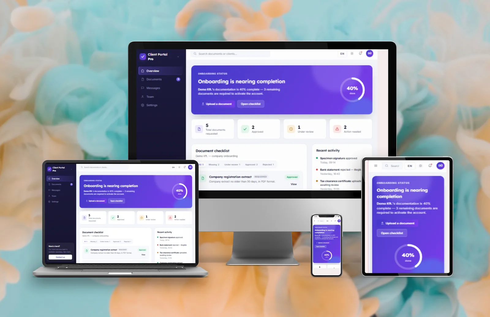
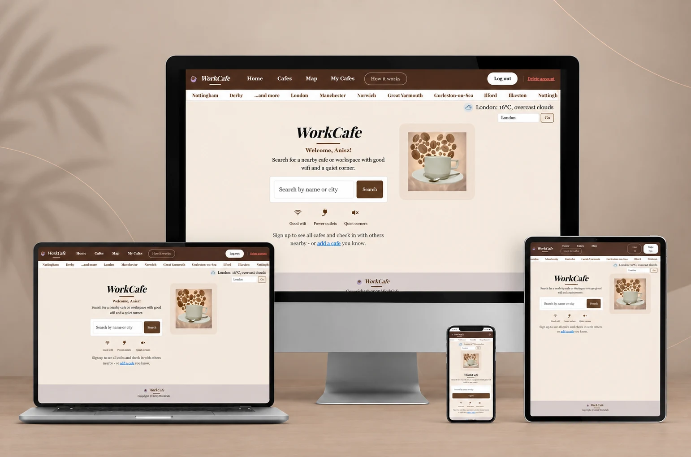
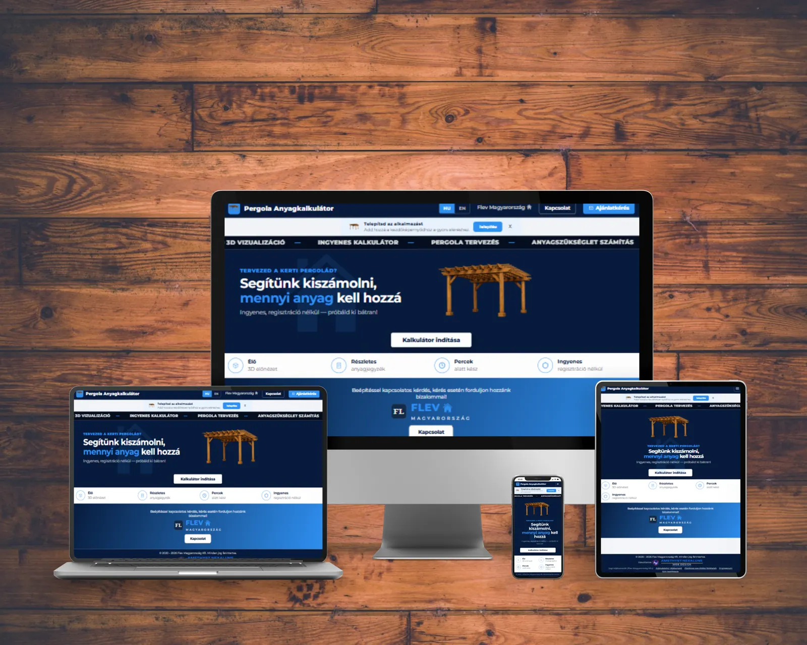
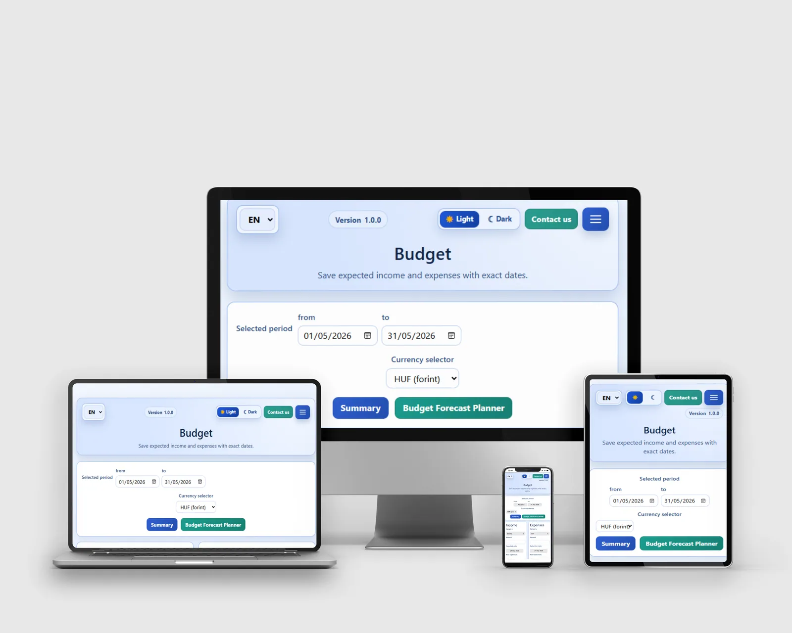
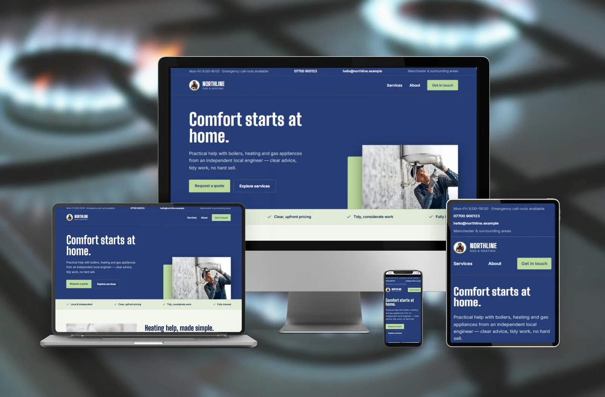
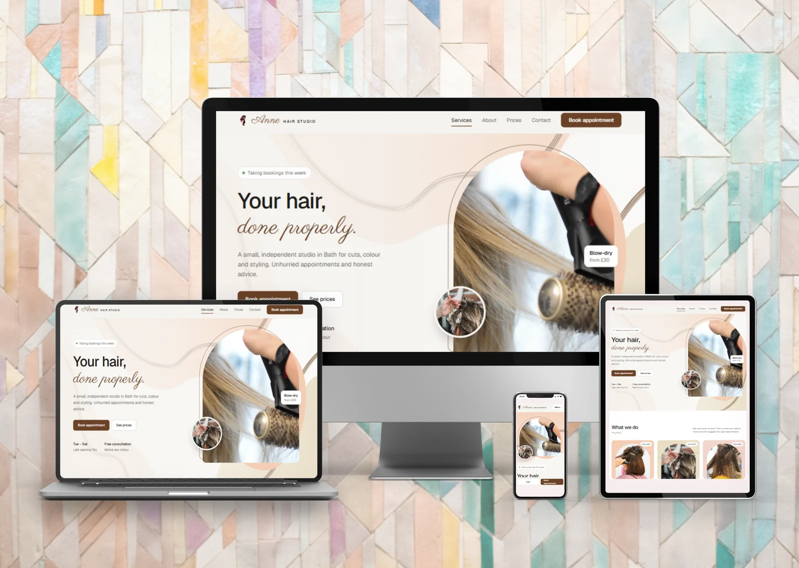

<div align="center">

# Anasztázia Karalyos-Kecskés · Portfolio

**Web Application Developer**: I build web apps with Python, Django and JavaScript, from the database model to a deployed, tested app.


[Skills](#-skills) · [Case studies](#-case-studies) · [Other projects](#-other-projects) · [Project structure](#-project-structure) · [Run locally](#-run-locally) · [Contact](#-contact)

</div>

---

## 📌 About

A portfolio and CV for web developer roles. The home page covers my profile and skills, short project cards, how I work, my experience and my education. Each main project has its own case study page, and the CV can be downloaded as a PDF.

🎓 **Currently studying:** Level 5 Diploma in Web Application Development at **South Staffordshire College** and **Code Institute** *(expected February 2027)*

💼 **Freelance:** web developer under the name [Amethyst Nexalune](https://www.amethyst-nexalune.co.uk) since August 2026, building websites, web apps and small business systems for clients in the UK and Hungary

## 🧰 Skills

| Area | Technologies |
| --- | --- |
| **Backend** | Python, Django, Node.js, REST APIs, C#, .NET |
| **Frontend** | JavaScript (ES6+), HTML, CSS, Bootstrap, Chart.js, Leaflet, Babylon.js |
| **Data** | PostgreSQL, SQLite, MySQL, Firebase (Auth, Firestore, Cloud Functions), Supabase |
| **Testing** | Django TestCase, Jest, Playwright, manual testing, W3C validation |
| **Tools** | Git & GitHub, Heroku, Render, Vercel, Make, Agile / Kanban |

## 🗂 Case studies

<table>
  <tr>
    <td width="50%" valign="top">
      
      <h3><a href="case-studies/client-portal.html">Client Portal</a></h3>
      Python · Django · SQLite · Render
    </td>
    <td width="50%" valign="top">
      
      <h3><a href="case-studies/workcafe.html">WorkCafe</a></h3>
      Python · Django · PostgreSQL · Leaflet · Heroku
    </td>
  </tr>
  <tr>
    <td width="50%" valign="top">
      
      <h3><a href="case-studies/pergola-calculator.html">Pergola Calculator</a></h3>
      JavaScript · Babylon.js · Firebase Cloud Functions <em>(client project)</em>
    </td>
    <td width="50%" valign="top">
      
      <h3><a href="case-studies/budgeting-app.html">Budgeting App</a></h3>
      JavaScript · Firebase · Chart.js · Jest
    </td>
  </tr>
  <tr>
    <td width="50%" valign="top">
      
      <h3><a href="case-studies/northline-automation.html">Northline Gas &amp; Heating</a></h3>
      Website + Make &amp; AI automation for quote requests
    </td>
    <td width="50%" valign="top">
      
      <h3><a href="case-studies/anne-hair-studio.html">Anne Hair Studio</a></h3>
      Salon website with a booking calendar in plain JavaScript
    </td>
  </tr>
</table>

Every case study follows the same structure:

> **Problem → What I built → Technical details → Code sample / diagram → Challenges & fixes → Next steps**

## 🧪 Other projects

| Project | What it does | Links |
| --- | --- | --- |
| **LaunchTrack LMS** | Staff training: 11 modules that unlock in order, quizzes with a 90% pass mark, PDF certificates | [Demo](https://lms-demo-w8lj.onrender.com) |
| **Quote Tracker** | Quotes, follow-up dates and statuses in one place, with reminders and one-click acceptance | [Demo](https://quote-demo.onrender.com) |
| **Rental Tracker** | Tracks equipment out and due back, calculates fees and deposits, signed handovers | [Demo](https://rental-demo.onrender.com) |
| **Fishing Logbook** | Offline-first catch log with photos, synced to Supabase, with accounts and password reset | [Demo](https://fishing-logbook.amethyst-nexalune.co.uk/) · [Code](https://github.com/Anasztazia12/fishing-logbook) |
| **Maths Challenge** | Timed maths game for children aged 8–9, with progress tracking and avatars | [Demo](https://maths-challenge.amethyst-nexalune.co.uk/) · [Code](https://github.com/Anasztazia12/Maths-Challenge) |

## 🛠 How this site is built

The portfolio site itself is deliberately simple, with no framework and no build step:

- **HTML & CSS**: CSS Grid and Flexbox, no framework
- **JavaScript**: about 15 lines of vanilla JS for the image sliders
- **System fonts**: Georgia for headings, Segoe UI / Arial for body text, so there are no font files to load

## 📁 Project structure

```text
portfolio-website/
├── index.html              # Home: profile, case studies, other projects, how I work, experience, education
├── cv.html                 # Printable CV (the PDF is generated from this page)
├── case-studies/           # One page per project
│   ├── client-portal.html
│   ├── workcafe.html
│   ├── pergola-calculator.html
│   ├── budgeting-app.html
│   ├── northline-automation.html
│   └── anne-hair-studio.html
└── assets/
    ├── css/style.css       # All styles, grouped by section with comments
    ├── js/main.js          # Image sliders on the case study pages
    ├── images/             # Screenshots, certificates, favicon
    └── pdf/                # Downloadable CV
```

## 📱 Responsive layout

| Screen width | Layout |
| --- | --- |
| **Desktop** (≥ 900px) | Fixed dark sidebar on the left, content on the right |
| **Tablet / mobile** (< 900px) | Sidebar moves to the top, menu becomes a single row |
| **Small phones** (< 600px) | Two-column parts (problem / solution, dates / details) stack into one column |

## 🚀 Run locally

No build step and no dependencies.

```bash
git clone https://github.com/Anasztazia12/portfolio.git
cd portfolio
```

Then open `index.html` in a browser, or use the **Live Server** extension in VS Code.

## 📄 Updating the CV PDF

The PDF is generated from `cv.html` with headless Chrome. After editing `cv.html`, run this from the project folder:

```bash
"C:/Program Files/Google/Chrome/Application/chrome.exe" --headless --no-pdf-header-footer \
  --print-to-pdf="assets/pdf/CV_Anasztazia_Karalyos-Kecskes.pdf" cv.html
```

Alternatively, open `cv.html` in a browser, press <kbd>Ctrl</kbd> + <kbd>P</kbd> and choose **Save as PDF**.

## 🌐 Deployment

The site is fully static, so it runs on GitHub Pages:

1. Go to **Settings → Pages** in the repository.
2. Choose the `main` branch and the `/ (root)` folder.
3. The site is published at `https://anasztazia12.github.io/portfolio/`.

## ✅ Testing

- Checked in Chrome at desktop (1366px) and phone (390px) widths
- All project links verified against the live demos and GitHub repositories

## 📬 Contact

- **Email:** [kecskes.anasztazia@gmail.com](mailto:kecskes.anasztazia@gmail.com)
- **GitHub:** [@Anasztazia12](https://github.com/Anasztazia12)
- **Website:** [amethyst-nexalune.co.uk](https://www.amethyst-nexalune.co.uk)
